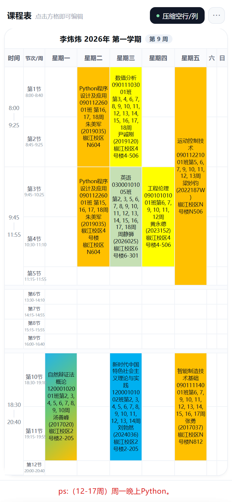
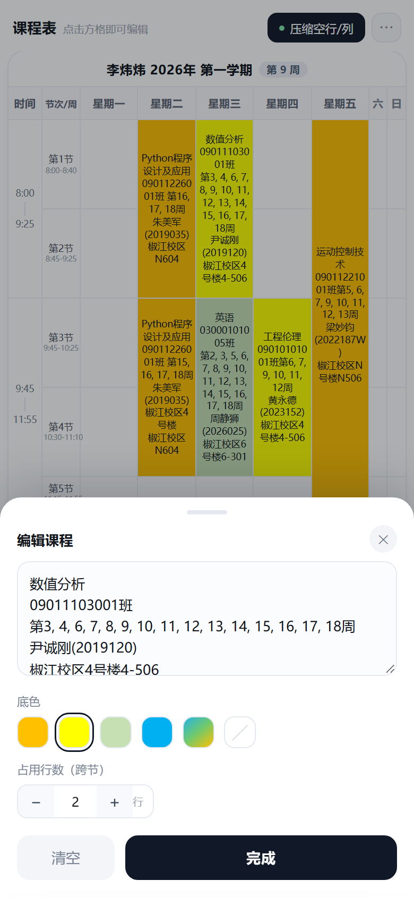
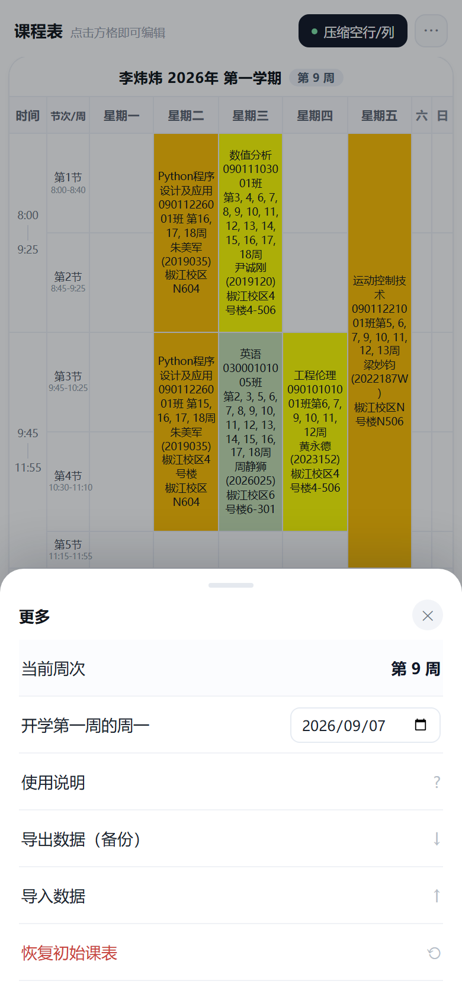

# 📅 课程表（手机版）

一张能随手改的手机课表。**单文件 HTML + PWA**：装到桌面后像 App 一样全屏打开，断网也能用。



---

## 特点

| | |
|---|---|
| **装成 App** | 手机打开链接 → 添加到主屏幕，有图标、全屏、无地址栏，断网可用 |
| **单文件** | 核心就是一个 `index.html`，零依赖，本地双击也能开 |
| **随手改** | 点任意格子改文字；课程格可选底色、设定跨几节合并 |
| **自动时间段** | 第一列的「8:00 ┊ 9:25」按“大课间”自动划分，本周没课的时段自动留白 |
| **空行自动压缩** | 没课的行收成细条；周六、周日是常驻的窄条备用列 |
| **周次自动更新** | 标题旁的「第 9 周」按开学日期自动计算 |
| **本地保存** | 改动存在浏览器里，刷新不丢；支持导出 / 导入 JSON 备份 |

## 界面

| 编辑课程 | 更多设置 |
|:---:|:---:|
|  |  |

---

## 装成 App（推荐）

部署到 GitHub Pages 后（HTTPS 环境才支持安装与离线缓存）：

- **iPhone**：用 **Safari** 打开链接 → 分享按钮 → **添加到主屏幕**
- **Android**：用 **Chrome** 打开链接 → 右上角菜单 → **安装应用**
- **电脑 Chrome/Edge**：地址栏右侧的安装图标

装好后从桌面图标打开：没有地址栏、全屏显示、断网也能打开课表（首次打开后缓存好）。
想更新版本时，把 `service-worker.js` 里的 `VERSION` 改一下再推上去即可。

## 怎么用

### 方式一：直接打开（最简单）

下载 `index.html`，双击用浏览器打开即可。这种方式没有 Service Worker，不能离线缓存，但功能完全一样。

### 方式二：GitHub Pages（推荐分享）

1. 新建一个仓库，把本目录的文件**全部**上传（含 `icons/`、`docs/`、`examples/`）
2. 仓库 → **Settings → Pages** → Source 选 `Deploy from a branch`，分支 `main`、目录 `/ (root)`
3. 等 1 分钟左右，访问 `https://<你的用户名>.github.io/<仓库名>/`
4. 手机上打开同一网址，按上面「装成 App」的步骤添加到主屏幕

> `index.html` 必须在根目录，GitHub Pages 才会默认打开它；`manifest.json` 和 `service-worker.js` 也要在根目录。

### 方式三：局域网给手机临时看

电脑上在该目录执行 `python -m http.server 8000`，手机连同一个 WiFi 打开 `http://电脑IP:8000/`。
（HTTP 下浏览器不允许 Service Worker，所以只能预览，不能离线/安装。）

---

## 换成自己的课表

- **直接改**：点格子改文字、选底色、设跨节数
- **空白模板**：`⋯ → 导入数据 → examples/空白课表.json`，得到一张只有节次时间的空表
- **节次时间**：点第二列的「第N节」，可以改课名和上下课时间（第一列的时间段会跟着重算）
- **开学日期**：`⋯ → 开学第一周的周一`，标题里的「第 X 周」就按它算
- **改内置示例**：编辑 `index.html`，搜索 `DEFAULT_ROWS`（节次与时间）和 `DEFAULT_BLOCKS`（课程内容）

## 数据说明

所有改动保存在浏览器的 **localStorage**，只在当前设备的当前浏览器有效：

- 换设备 / 换浏览器 / 清理缓存 → 数据不会跟过去
- 换设备时：`⋯ → 导出数据` 得到 JSON，在新设备 `导入数据` 即可

## 文件说明

```
index.html             主程序（单文件应用）
manifest.json          PWA 清单：名称、图标、启动方式
service-worker.js      离线缓存
icons/                 各尺寸图标（主屏、maskable、iOS、favicon）
docs/                  README 用的截图
examples/空白课表.json  空白模板，导入即清空
```

## 兼容性

Chrome / Edge / Safari / Firefox 等现代浏览器。界面按 390–430px 手机宽度设计，320px 也能用（字号会自动缩小）。

## 许可

[MIT](LICENSE)，随便用、随便改、随便转发。

---

### 更新记录

- **v1.1** — 支持安装到桌面（PWA）：应用图标、全屏启动、离线可用；新增空白课表模板。
- **v1.0** — 完成表格化课表：可编辑单元格、底色、跨节合并、自动时间段、空行压缩、周六周日备用列、周次自动计算、数据导入导出。
